<h1 align="center">readme/stats</h1>

<p align="center">
  Tarjetas SVG con tus estadísticas de GitHub, listas para tu perfil o el README de cualquier repositorio.<br/>
  Diseñadas desde un estudio visual con vista previa en vivo, más de 100 temas y 6 idiomas.
</p>

<p align="center">
  <a href="https://readme-stats-two-rouge.vercel.app/"></a>
  
  
  <a href="./LICENSE"></a>
</p>

<p align="center">
  <a href="https://readme-stats-two-rouge.vercel.app/">
    
  </a>
</p>

<p align="center">
  <a href="https://readme-stats-two-rouge.vercel.app/"><b>Abrir el estudio →</b></a>
</p>

---

## Contenido

- [Características](#características)
- [Tarjetas](#tarjetas)
- [El estudio web](#el-estudio-web)
- [Uso rápido](#uso-rápido)
- [Personalización](#personalización)
- [Referencia de parámetros](#referencia-de-parámetros)
- [Instalación local](#instalación-local)
- [Despliegue en Vercel](#despliegue-en-vercel)
- [Seguridad y caché](#seguridad-y-caché)
- [Estructura del proyecto](#estructura-del-proyecto)
- [Solución de problemas](#solución-de-problemas)

---

## Características

| | |
| --- | --- |
| **4 tarjetas + combinada** | Stats con rank, lenguajes más usados, racha de contribuciones y gráfica de actividad, o las 4 en una sola imagen. |
| **Estudio visual** | Vista previa en vivo, sin escribir URLs a mano. Copia el resultado en Markdown, HTML o URL. |
| **+100 temas** | `dracula`, `tokyonight`, `nord`, `github_dark`, `catppuccin`, temas con degradado… o tus propios colores. |
| **6 idiomas** | Inglés, español, portugués, francés, alemán e italiano. Commits, PRs e Issues se mantienen en inglés. |
| **Control del contenido** | Título propio, filas visibles, rank, iconos, borde, lenguajes excluidos y rango de días. |
| **Listo para producción** | Entradas validadas, CSP en cada tarjeta, caché en CDN y límite de peticiones. |

---

## Tarjetas

<table>
  <tr>
    <td align="center"><b>Stats</b><br/><code>/api/card/stats</code></td>
    <td align="center"><b>Lenguajes</b><br/><code>/api/card/languages</code></td>
  </tr>
  <tr>
    <td></td>
    <td>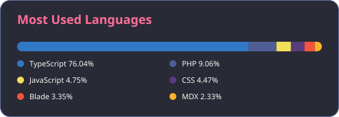</td>
  </tr>
  <tr>
    <td align="center" colspan="2"><b>Racha</b> · <code>/api/card/streak</code></td>
  </tr>
  <tr>
    <td align="center" colspan="2">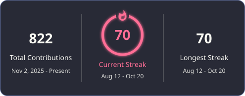</td>
  </tr>
  <tr>
    <td align="center" colspan="2"><b>Actividad</b> · <code>/api/card/contributions</code></td>
  </tr>
  <tr>
    <td align="center" colspan="2">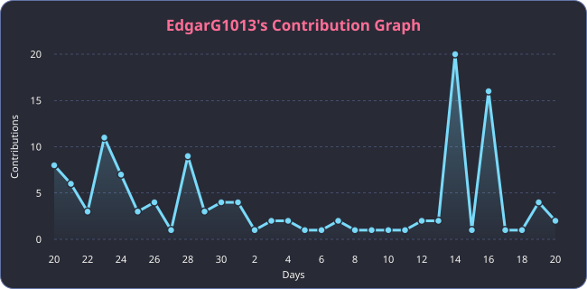</td>
  </tr>
</table>

- **Stats**: estrellas, commits del último año, PRs, issues, repositorios a los que contribuiste y un anillo con tu **rank** (S → C).
- **Lenguajes**: barra proporcional con hasta 10 lenguajes, calculada sobre tus repositorios propios.
- **Racha**: contribuciones del último año, racha actual (días seguidos hasta hoy) y la racha más larga.
- **Actividad**: gráfica de contribuciones diarias de los últimos 7 a 365 días.
- **Todas**: `/api/card/all` apila las 4 tarjetas en una sola imagen SVG.

---

## El estudio web

El proyecto incluye un frontend (`ui/`) para crear tus tarjetas visualmente. Pruébalo en **[readme-stats-two-rouge.vercel.app](https://readme-stats-two-rouge.vercel.app/)**, o en local en `http://localhost:3000` tras `npm start`.

1. **Escribe tu usuario** de GitHub, o prueba con una de las sugerencias.
2. **Elige la tarjeta**: Stats, Lenguajes, Racha, Actividad o Todas.
3. **Elige un tema** en la cuadrícula de muestras, con buscador.
4. **Ajusta el contenido** (idioma, título, filas, rank, iconos, lenguajes) y **el estilo** (colores, degradado, radio del borde).
5. **Copia** el snippet en Markdown, HTML o URL y pégalo en tu README.

Cada cambio regenera la vista previa al instante. Puedes ver la tarjeta sobre fondo claro u oscuro, y la configuración queda guardada en la URL de la página para compartirla.

---

## Uso rápido

Añade una imagen que apunte a la API:

```markdown

```

Para poner dos tarjetas lado a lado:

```html
<p align="center">
  
  
</p>
```

> En un despliegue propio, reemplaza `readme-stats-two-rouge.vercel.app` por tu dominio.

---

## Personalización

### Temas

Usa `?theme=<nombre>`; por defecto es `dracula`. La lista completa, con sus colores, está en [`/api/themes`](https://readme-stats-two-rouge.vercel.app/api/themes).

<p align="center">
  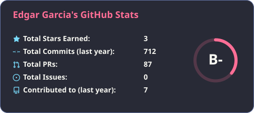
  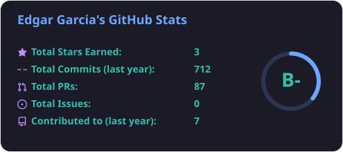
  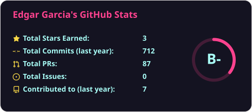
</p>
<p align="center">
  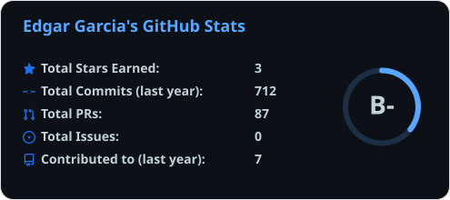
  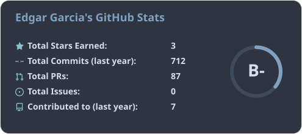
  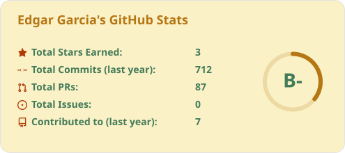
</p>

### Colores y degradados

Cualquier color que pases tiene prioridad sobre el tema, así que puedes partir de un tema y cambiar solo un color. Los valores van en hexadecimal sin `#`.

```text
&title_color=ff6e96&text_color=f8f8f2&icon_color=79dafa&bg_color=282a36&border_color=3f4258&ring_color=ff6e96
```

`bg_color` también acepta un **degradado** con el formato `ángulo,color1,color2[,…]` (de 2 a 5 colores):

```text
&bg_color=35,4158d0,c850c0,ffcc70
```

<p align="center">
  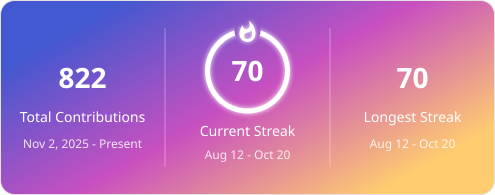
</p>

### Idioma

`&locale=es` traduce títulos, etiquetas y fechas, y adapta el formato de números y fechas. Los términos técnicos (Commits, PRs, Issues) no se traducen.

Idiomas disponibles: `en` · `es` · `pt` · `fr` · `de` · `it`

<p align="center">
  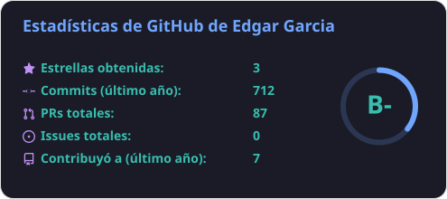
</p>

### Contenido y forma

```text
&custom_title=Mi%20actividad&hide=issues,contribs&hide_rank=true
```

<p align="center">
  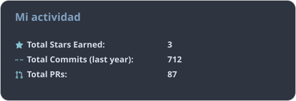
  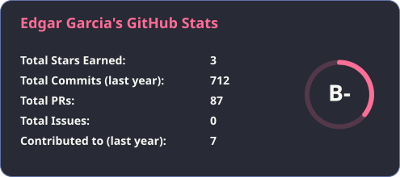
</p>

`border_radius` controla el redondeo de las esquinas (de 0 a 50 px):

<p align="center">
  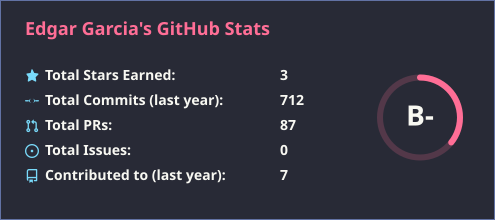
  
  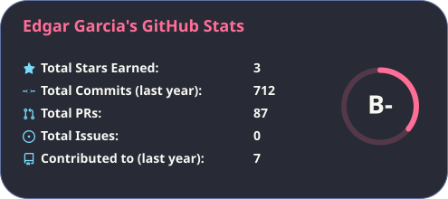
</p>

---

## Referencia de parámetros

**Comunes a todas las tarjetas**

| Parámetro | Tipo | Descripción | Default |
| --- | --- | --- | --- |
| `username` | string | **Requerido.** Usuario de GitHub | — |
| `theme` | string | Nombre del tema (ver `/api/themes`) | `dracula` |
| `locale` | string | `en`, `es`, `pt`, `fr`, `de`, `it` | `en` |
| `title_color` · `text_color` · `icon_color` | hex | Título, texto e iconos/acentos | según tema |
| `bg_color` | hex o degradado | Fondo (`ángulo,color1,color2,…` para degradado) | según tema |
| `border_color` · `ring_color` | hex | Borde y anillos de progreso | según tema |
| `border_radius` | 0–50 | Radio de las esquinas en px | `14` |
| `hide_border` | boolean | Oculta el borde | `false` |
| `hide_title` | boolean | Oculta el título (stats, languages, contributions) | `false` |
| `custom_title` | string | Título propio, máx. 60 caracteres | según tarjeta |

**Específicos de cada tarjeta**

| Tarjeta | Parámetro | Descripción | Default |
| --- | --- | --- | --- |
| `stats` | `hide` | Filas a ocultar: `stars,commits,prs,issues,contribs` | — |
| `stats` | `hide_rank` | Oculta el anillo de rank | `false` |
| `stats` | `hide_icons` | Oculta los iconos (alias de `show_icons=false`) | `false` |
| `languages` | `langs_count` | Lenguajes a mostrar (1–10) | `6` |
| `languages` | `exclude` | Lenguajes a excluir, separados por comas | — |
| `contributions` | `days` | Días recientes a graficar (7–365) | `31` |

`/api/card/all` acepta todos los parámetros anteriores y los aplica a cada tarjeta. Los valores fuera de rango se ajustan al límite y los colores que no son hexadecimales válidos se ignoran.

---

## Instalación local

Requisitos: Node.js 18 o superior y un [token de GitHub](https://github.com/settings/tokens) con permiso `public_repo` (o `repo` para incluir repositorios privados).

```bash
git clone https://github.com/EdgarG1013/README-STATS.git
cd README-STATS
npm install
cp .env.example .env   # añade tu GITHUB_TOKEN
npm start
```

El estudio queda en `http://localhost:3000` y la API en `/api/card/*`.

| Variable | Descripción | Default |
| --- | --- | --- |
| `GITHUB_TOKEN` | Token de GitHub (requerido) | — |
| `PAT_1`, `PAT_2`, … | Tokens adicionales que se rotan para repartir el rate limit | — |
| `PORT` | Puerto del servidor local | `3000` |
| `RATE_LIMIT_MAX` | Peticiones de tarjetas por IP y minuto | `60` |

---

## Despliegue en Vercel

1. Importa el repositorio en [Vercel](https://vercel.com/new). `vercel.json` ya está configurado.
2. Añade `GITHUB_TOKEN` en **Settings → Environment Variables**.
3. Despliega. El estudio y la API se sirven desde el mismo dominio.

> **Recomendado:** el límite de peticiones integrado vive en la memoria de cada instancia. Para un límite estricto, añade una regla de *rate limiting* en el **Vercel Firewall**.

---

## Seguridad y caché

- **Entradas validadas:** usuario, colores, números y textos se validan y escapan antes de llegar al SVG.
- **CSP estricta:** cada tarjeta se sirve con una política que impide ejecutar scripts, y el estudio no se puede incrustar en otros sitios.
- **Errores limpios:** respuestas `400`, `404`, `429`, `502` o `503`, sin detalles internos.
- **Caché:** 30 min en el navegador y 4 h en la CDN de Vercel; además, una caché en memoria de 10 min y deduplicación de peticiones simultáneas. Las visitas a tu README no gastan el token.
- **GitHub API:** timeout de 10 s, rotación de tokens y ningún reintento cuando el usuario no existe.

---

## Estructura del proyecto

```text
api/
  index.js             Rutas Express, cabeceras de seguridad, caché y rate limit
  options.js           Validación y normalización de los parámetros
  card.js              Consultas GraphQL a GitHub y cálculo de rachas
  themes.cjs           Temas usados por los renderers
  cards/
    stats.cjs          Tarjeta de estadísticas + rank
    languages.cjs      Lenguajes más usados
    streak.cjs         Racha de contribuciones
    contributions.cjs  Gráfica de actividad
    common.cjs         Colores, fondo/degradado, borde y título compartidos
    i18n.cjs           Traducciones de las tarjetas
src/themes/            Catálogo adicional de temas
ui/                    Estudio web (HTML, CSS y JS sin dependencias)
docs/                  GIF de la demo y SVG de ejemplo
```

---

## Solución de problemas

| Problema | Solución |
| --- | --- |
| `Missing username parameter` | Añade `?username=tu_usuario` a la URL. |
| `GitHub token not configured` | Define `GITHUB_TOKEN` en `.env` o en las variables de Vercel. |
| `503` / rate limit de GitHub | Añade más tokens (`PAT_1`, `PAT_2`, …) o espera a que se reinicie el límite. |
| La tarjeta no se actualiza en GitHub | GitHub cachea las imágenes; espera unos minutos o añade un parámetro como `&v=2`. |

---

## Licencia

[MIT](./LICENSE). Inspirado en [github-readme-stats](https://github.com/anuraghazra/github-readme-stats), [github-readme-streak-stats](https://github.com/DenverCoder1/github-readme-streak-stats) y [github-readme-activity-graph](https://github.com/Ashutosh00710/github-readme-activity-graph).
